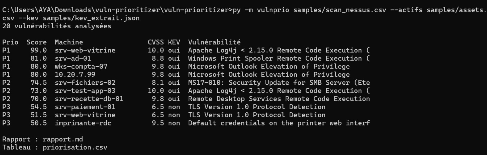

# Vulnerability Prioritizer

Outil en Python qui transforme l'export d'un scanner de vulnérabilités en **liste d'actions ordonnée par risque réel**, avec un délai de correction et la justification de chaque score.

## Le problème

Un scan produit des centaines de lignes et l'équipe ne peut pas tout corriger tout de suite. Trier par gravité technique (CVSS) seule ne suffit pas :

- une faille « critique » sur une machine de test isolée est moins urgente qu'une faille « élevée » sur un serveur accessible depuis Internet ;
- une faille que des attaquants **exploitent déjà** doit passer avant une faille seulement théorique.

L'outil croise donc quatre informations : la gravité (CVSS), l'exploitation active (catalogue **CISA KEV**), l'importance du bien et son exposition.

## Ce dont il a besoin

| Entrée | Contenu | Obligatoire |
|---|---|---|
| Export du scanner | CSV de type Nessus (Host, Name, CVE, CVSS, Risk, Port, Solution) | oui |
| Inventaire | CSV : `host`, `ip`, `criticite` (1 à 5 ou critique/haute/moyenne/basse), `exposition`, `environnement` | non, mais conseillé |
| Catalogue KEV | JSON officiel de la CISA, téléchargeable par l'outil | non, mais conseillé |

Sans inventaire, toutes les machines reçoivent une importance moyenne. Sans KEV, le critère « exploitée activement » est ignoré, et l'outil le dit en clair dans le rapport.

## Le score (0 à 100)

| Facteur | Points |
|---|---|
| Gravité technique : CVSS × 5 | 0 à 50 |
| Faille au catalogue CISA KEV (exploitée activement) | +25 |
| ... avec usage connu par des rançongiciels | +5 |
| Importance du bien : (criticité − 1) × 3 | 0 à 12 |
| Accessible depuis Internet | +10 |
| Environnement de test ou de recette | −10 |

| Score | Priorité | Délai de correction |
|---|---|---|
| 80 et plus | P1 | 48 heures |
| 60 à 79 | P2 | 7 jours |
| 40 à 59 | P3 | 30 jours |
| moins de 40 | P4 | 90 jours |

Chaque résultat affiche ses raisons point par point. Les poids et les délais sont des **choix pédagogiques**, pas un standard : à adapter à la politique de l'entreprise.

## Utilisation

Python 3.9 ou plus, rien à installer.

```bash
python generate_sample_data.py     # crée des données fictives dans samples/
python -m vulnprio samples/scan_nessus.csv --actifs samples/assets.csv --kev samples/kev_extrait.json
```

Avec le vrai catalogue de la CISA (téléchargé par l'outil, puis réutilisé) :

```bash
python -m vulnprio mon_scan.csv --actifs mes_actifs.csv --update-kev kev.json
```

| Option | Rôle |
|---|---|
| `--actifs` | inventaire des machines |
| `--kev` | catalogue KEV local (JSON) |
| `--update-kev FICHIER` | télécharge le catalogue officiel dans ce fichier, vérifie qu'il est valide, puis l'utilise |
| `--sortie-md`, `--sortie-csv` | fichiers de sortie (`rapport.md` et `priorisation.csv` par défaut) |
| `--top` | taille du classement affiché (10 par défaut) |

## Ce que produit l'outil

- **Un rapport Markdown** : synthèse par priorité, ce que la priorisation change par rapport au CVSS seul, les vulnérabilités à traiter en premier, les machines les plus exposées, les **gains rapides** (un correctif qui règle plusieurs vulnérabilités), les machines absentes de l'inventaire et le détail des P1.
- **Un tableau CSV** (séparateur point-virgule, ouvrable dans Excel).

Exemple sur les données fictives :

```
Prio  Score  Machine                CVSS KEV  Vulnérabilité
P1     99.0  srv-web-vitrine        10.0 oui  Apache Log4j < 2.15.0 Remote Code Execution (
P1     81.0  srv-ad-01               8.8 oui  Windows Print Spooler Remote Code Execution (
P1     80.0  wks-compta-07           9.8 oui  Microsoft Outlook Elevation of Privilege
P2     74.5  srv-fichiers-02         8.1 oui  MS17-010: Security Update for SMB Server (Ete
P2     73.0  srv-test-app-03        10.0 oui  Apache Log4j < 2.15.0 Remote Code Execution (
```

La même faille Log4Shell (CVSS 10) est P1 sur le serveur web exposé et P2 sur la machine de test. Un « critique » CVSS 10 sur une machine de test (système d'exploitation obsolète) tombe en P3. Rapport complet : [`examples/rapport-exemple.md`](examples/rapport-exemple.md).
## Capture


## Données d'exemple : à lire

- Tout est **fictif** : banque, machines, adresses.
- Le fichier `samples/kev_extrait.json` est un **extrait de démonstration** que j'ai écrit à la main. **Ce n'est pas le catalogue officiel** et il ne doit pas servir de source. Pour de vrais résultats, utilise `--update-kev`.
- Les noms de vulnérabilités et les CVE sont réels, mais leurs scores et leur présence dans l'extrait sont là pour la démonstration.

## Tests

```bash
python -m unittest discover -s tests -v
```

26 tests : lecture de fichiers (séparateurs, décimales, CVE multiples, doublons, colonnes manquantes, valeurs invalides), calcul de chaque facteur du score et ses bornes, résultats sur l'échantillon, rapport et CSV, téléchargement KEV simulé (contenu valide, contenu invalide), commande de bout en bout.

## Limites

- **Heuristique** : les poids sont arbitraires. Une faille sans authentification facile à exploiter (mot de passe par défaut, par exemple) peut être sous-évaluée si son CVSS est estimé et son bien peu critique.
- **Pas d'EPSS** (probabilité d'exploitation) ni d'accès réseau aux détails de chaque CVE.
- Le catalogue KEV ne couvre que ce que la CISA a recensé : une absence ne veut pas dire « non exploitée ».
- Format Nessus uniquement (les noms de colonnes sont souples, mais d'autres scanners ne sont pas testés).
- Le **téléchargement du vrai catalogue n'a été testé qu'avec un serveur simulé**, pas contre le site de la CISA.
- L'importance et l'exposition des machines viennent de l'inventaire : s'il est faux, le classement l'est aussi.

## Pistes d'amélioration

Intégrer EPSS, importer d'autres formats (OpenVAS, Qualys), tenir compte de l'âge de la faille et des correctifs compensatoires, suivre l'évolution entre deux scans.
